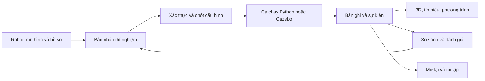
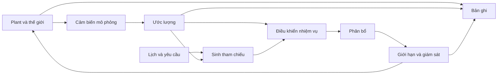
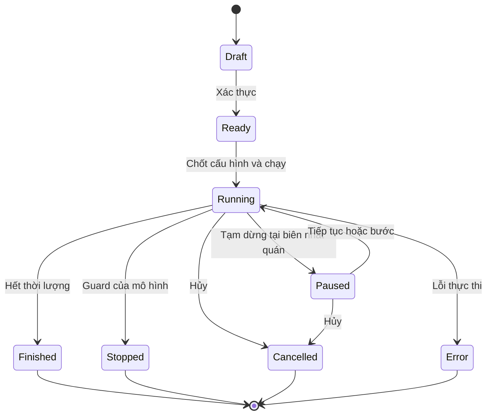

# Thiết kế chi tiết nền tảng mô phỏng DUK

**Đề xuất kỹ thuật · 19/11/2026 · hiện trạng tại `bd9b402`.** Tài liệu triển khai [kế hoạch chức năng](simulation-platform-plan.md) thành thiết kế sản phẩm, ngữ nghĩa dữ liệu, vòng chạy, tích hợp và nghiệm thu. Các thực thể dưới đây mô tả trách nhiệm và ngữ nghĩa. Tên trường, API, ngưỡng kỹ thuật và giả thiết vật lý cụ thể chờ phép kiểm và quyết định của dự án.

## 1. Đơn vị làm việc là một thí nghiệm

Một dự án DUK giữ robot, các mô hình dùng được, nguồn tham số, thế giới, các phiên bản thí nghiệm và lịch sử kết quả. Người dùng bắt đầu từ bài mẫu hoặc thí nghiệm trống, chọn đối tượng, đặt câu hỏi, dựng điều kiện và ghép các khâu cần dùng. Sau khi chạy, họ quay lại đúng đối tượng, lệnh, thời điểm và phương trình chi phối hiện tượng. Mỗi biến thể có nguồn và tập thay đổi để giải thích khác biệt.

| Hành trình | Việc người dùng làm | Đầu ra có thể dùng tiếp |
| --- | --- | --- |
| **Khảo sát cơ khí** | Chọn hông trái hoặc thanh BC. Đặt tư thế, tốc độ, gia tốc, tải và quỹ đạo. Quét miền góc, giải IK, kiểm nhánh lắp, kỳ dị, tải và hành trình. Đặt hai chân độc lập để xem trong hệ thân và thế giới. | Workspace, quỹ đạo, Jacobian, kiểm bất biến, mô-men yêu cầu/giới hạn và tư thế ứng viên cho bài động. |
| **Điều khiển toàn robot** | Chọn trạng thái đầu, mặt đỡ, hồ sơ, chuỗi lệnh và nhiễu. Ghép nguồn phản hồi, sinh tham chiếu, điều khiển, phân bổ và giám sát. Chạy, pause, bước tiến và thay lệnh nếu mô hình hỗ trợ. | Tư thế, đường đi của lệnh, lực, sự kiện và điều kiện kết thúc, có thể phát lại theo mẫu. |
| **Giải thích và kiểm chứng** | Chọn đối tượng/mốc. Tìm lực, giới hạn, gia tốc và cơ chế điều khiển. Tạo biến thể, thay một khâu, quét tham số và kiểm hội tụ. | Chỉ số và sai khác truy được về từng ca, cấu hình, mẫu và nguồn. |
| **Đối chiếu mô hình** | Chạy các điều kiện dùng chung trên Python và Gazebo khi tương thích. Phân tích từ cơ cấu đến tiếp xúc, vòng kín và dữ liệu đo khi có. | Báo cáo phần giao nhau, sai khác và bằng chứng về mô hình, số học hoặc vật lý. |

## 2. Cơ sở nghiên cứu và lựa chọn thiết kế

| Bằng chứng hoặc lựa chọn | Kết luận áp dụng cho DUK |
| --- | --- |
| **Lõi hiện tại có giá trị.** NB3–NB6 đã có API, test và mô hình với giả thiết khác nhau. Workbench dispatch theo bài. Adapter vật chất hóa các cột kết quả. | Bọc các mô hình bằng hợp đồng thí nghiệm và danh mục khả năng. Migrate theo từng runner. Dùng test đặc trưng hiện tại để phát hiện đổi ngữ nghĩa. [Core](../software/core.md#simulation-entry-points) · [Workbench](https://github.com/anmh1205/duk/blob/bd9b40286ac29da8ba6e3b88e0b8d81f4599096f/applications/operator-dashboard/workbench/session.py#L69) |
| **Một bộ tích phân tổng quát hay nhiều runner?** NB3 tích phân thích nghi, NB4 có trễ lấy mẫu, NB5 tích phân mô hình rút gọn với hông đặt, NB6 dùng tick và substep. | Chuẩn hóa vòng đời chạy và nghĩa của đầu vào, đầu ra, sự kiện. Giữ bộ giải và cơ chế event sau adapter từng mô hình. Chỉ chia sẻ thuật toán số khi hai bên có cùng yêu cầu và giả thiết. [NB3](../../robot/software/core/src/duk_core/simulation/planar.py) · [NB6](../../robot/software/core/src/duk_core/simulation/whole_body.py) |
| **Ghép khối có chu kỳ và trạng thái riêng.** Drake mô tả trước/sau cập nhật rời rạc. FMI có clock, phân vùng thực thi và công bố khả năng lấy/đặt state. | DUK nên có mô tả cổng, pha cập nhật và khả năng checkpoint. Giữ công thức và solver trong core. Tích hợp phần mềm ngoài khi có nhu cầu trao đổi cụ thể. [Drake Simulator](https://drake.mit.edu/doxygen_cxx/classdrake_1_1systems_1_1_simulator.html) · [FMI 3.0.2](https://fmi-standard.org/docs/3.0.2/) |
| **Khép vòng trong Gazebo có rủi ro riêng.** Tài liệu Harmonic đánh dấu closed kinematic chains có issue. Báo cáo gz-physics mô tả lỗi khi đổi hướng trục trên cơ cấu và cấu hình khác DUK. | Thử một chân trên bộ package dự kiến, có tải và đổi hướng toàn cụm, trước khi làm backend hai chân. Cổng qua gồm sai số closure, phản lực và ổn định. [Gazebo Harmonic](https://gazebosim.org/docs/harmonic/comparison/) · [Báo cáo gz-physics](https://github.com/gazebosim/gz-physics/issues/719) |
| **Manifest thực nghiệm và log vận chuyển có mục đích riêng.** RunRecord chứa đầu vào và tín hiệu. Rosbag2 và MCAP ghi thông điệp, channel và mốc ghi/phát. | Giữ manifest DUK và ngữ nghĩa vật lý của tín hiệu. Thêm trao đổi ROS bag/MCAP khi cần đo hoặc xử lý log lớn. Khả năng đọc log phụ thuộc ánh xạ đúng nguồn, thời gian và frame. [RunRecord](../../applications/operator-dashboard/workbench/records.py#L124) · [Rosbag2](https://github.com/ros2/rosbag2) · [MCAP](https://mcap.dev/spec) |
| **Độ đúng phần mềm, số học và vật lý cần phép kiểm khác nhau.** NASA-STD-7009B phân biệt verification của triển khai/nghiệm và validation với hệ tham chiếu. | Parity Qt/core kiểm đường dữ liệu. Refinement kiểm sai số nghiệm. Gazebo hoặc dữ liệu đo cung cấp đối chiếu ngoài core trong miền áp dụng. [NASA-STD-7009B](https://standards.nasa.gov/standard/NASA/NASA-STD-7009) |

**Chọn đường triển khai đề xuất.** Qt là không gian làm việc chính. RViz quan sát pose/lực, notebook và CLI dùng cùng hợp đồng thí nghiệm. Ghép thuật toán bằng danh mục khâu theo vai trò trước. Thử runner tương tác đầu tiên ở NB6 do có tick điều khiển và substep rõ. Gazebo dùng làm backend đối chiếu có khả năng được công bố sau kiểm.

## 3. Mô hình robot và bảng khả năng

Dự án có cây robot → thân/chân trái/phải → khâu/khớp/bánh, cùng motor, điểm hình học và frame. Một định danh bộ phận dùng cho cây Qt, chọn trong 3D, đối tượng của sự kiện và kênh tín hiệu. H là điểm phụ trợ, O là tâm bánh, BCO là cụm cứng. Góc hình học hông và encoder cần ánh xạ đã hiệu chuẩn nếu sử dụng dữ liệu thật. Kênh có cùng đích hiển thị được đánh dấu là **gốc**, **suy ra** hoặc **không có** theo mô hình. [Geometry DUK](../../robot/config/physical/README.md) · [Mô hình toán](../theory/modeling.md)

| Mô hình | Vai trò | Tính năng cần bổ sung và ranh giới |
| --- | --- | --- |
| **NB1–NB2** | FK/IK, quỹ đạo, tải tĩnh và đường bao motor. | Workspace toàn miền, nhiều mốc độc lập cho hai bên, kiểm đạo hàm, tải theo hướng và góc, phân rã mô-men và CoM/quán tính. Pose tĩnh là ứng viên khi chuyển sang động. |
| **NB3** | Mô hình phẳng 7 DOF, lăn cứng, mềm hoặc bay. | Trạng thái đầu, effort hở vòng, tải ngoài nếu hỗ trợ và log cơ học. Chỉ tiêu gần lăn, guard và luật chuyển chế độ. Lăn cứng hiện dừng khi mất khả thi, bay dừng khi chạm đất. |
| **NB4** | Con lắc hông cố định, mô-men tổng của hai bánh. | Thời lượng, ma trận phục hồi, so phản hồi/neo, trễ và mô-men trên cùng protocol. Viewer dùng minh họa mô hình gộp; tín hiệu theo từng bánh cần model khác. |
| **NB5** | Cân bằng với chuyển động hông đặt đối xứng. | So các chính sách trên cùng quỹ đạo. Thu phần dư và chi phí trước/từng tick. Mô-men hông là yêu cầu của chuyển động đặt. Bão hòa hông gây lệch quỹ đạo cần plant nhận effort hông. |
| **NB6** | Whole-body 3D, bốn effort, contact mềm riêng từng bánh, task và giám sát. | Trạng thái đầu bất đối xứng, lịch riêng từng tác vụ, ghép phản hồi, trace mô-men–lực–trạng thái, pause/step và batch. Hiện dùng đĩa mỏng, hai mặt ngang và một phần thông tin plant trong quan sát. |
| **Gazebo động** | Backend dự kiến cho cơ cấu, va chạm, sensor và world. | Hỗ trợ được công bố theo engine, phiên bản và phép kiểm. Preview hiện xác nhận pose, visual, TF và clock. |

**Chuyển giữa các cấp.** Khi lấy pose hoặc quỹ đạo NB1–NB2 cho bài động, giữ nguồn, frame, đơn vị, dấu và nhánh lắp. Kiểm state đầy đủ, vận tốc, khe hở, hành trình và điều kiện contact. Nếu phải giải lại tư thế cân bằng, giữ cả giá trị yêu cầu và giá trị thật dùng để chạy. Khi đưa kết quả động lên RViz, kiểm quy ước q, gốc robot và vòng quay tương đối. [Quan hệ hình học và ROS](kinematic-bench.md#geometry-and-ros-ownership)

Một phép ánh xạ phải nói rõ điểm gốc, chiều trục, đơn vị và góc tương đối. Geometry chân hiện lấy A làm gốc, chiều lên là y, và góc AB thỏa $\theta_{AB}=\theta_{DA}-q$. Khi đưa ra hình chiếu X–Z hoặc frame ROS, dùng phép đổi đã kiểm và đổi mm sang m ở biên. Mô hình lăn phẳng và con lắc NB4 dùng quy ước góc/vòng quay khác nhau. Test dấu lấy chuyển động tiến và quay bánh làm đối chứng. Với hai bánh, test một kích thích ở bên trái để phát hiện đảo kênh. [Quy ước DUK](../theory/modeling.md#coordinates-units-and-geometry) · [Đối chiếu dấu con lắc](../../research/experiments/duk-v3/notion-v3-review.md) · [ROS REP 103](https://github.com/ros-infrastructure/rep/blob/master/rep-0103.rst)

## 4. Dữ liệu và vòng đời thí nghiệm

| Thực thể | Nội dung cần giữ | Quy tắc |
| --- | --- | --- |
| **Robot và hồ sơ** | Topology, geometry, frame, số đo, cấu hình tổng hợp, nguồn và phiên bản. | Thay nội dung sinh phiên bản hoặc hash mới. Gắn mức chứng cứ theo tham số và bộ số. |
| **Bản nháp** | Model/backend, tư thế, quỹ đạo, thế giới, lịch, thuật toán, solver, seed, tín hiệu và tiêu chí. | Theo dõi giá trị kế thừa và override, kể cả override trùng mặc định. Sửa nháp không đổi ca đã chạy. |
| **Cấu hình đã giải quyết** | Mọi mặc định thực tế, mapping, graph đã kiểm, tham số và mốc dự kiến. | Chốt trước khi chạy. Gắn nội dung hoặc tài nguyên bất biến kiểm được trên máy khác. |
| **Ca chạy** | Danh tính cấu hình, code/engine, môi trường, trạng thái và tiến trình. Sự kiện tương tác nối vào nhật ký. | Một runner sở hữu trạng thái. Thử lại có id riêng và tham chiếu lần trước. |
| **Bản ghi** | Kênh, mẫu, khoảng lệnh, sự kiện, chỉ số, lý do kết thúc và mẫu cuối. | Đóng xong thì bất biến. Thiếu dữ liệu, dừng vật lý và lỗi runtime có nghĩa riêng. |
| **Mốc lưu trạng thái** | Trạng thái đầy đủ tại ranh giới xác định, model và cấu hình tương thích. | Có manifest phiên bản. Dùng để tiếp tục khi backend qua phép kiểm tương ứng. |
| **Kế hoạch đánh giá** | Tập biến thể, biến giữ, ngưỡng, metric, vùng hợp lệ, căn thời gian và nguồn chuẩn. | Chốt tiêu chí trước khi chạy. Báo kết quả từng ca và số ca đủ điều kiện ở mỗi phép so. |

**Trình xác thực** chạy theo thứ tự. Kiểm loại tệp, phiên bản, kiểu, shape và miền số. Kiểm tài nguyên, model, geometry và nguồn. Giải mặc định rồi kiểm trạng thái đầu, nhánh lắp, contact, mốc, đơn vị và chu kỳ. Kiểm khả năng của backend và các kết nối, sau đó chốt cấu hình. Lỗi mang vị trí đối tượng hoặc trường để Qt đưa người dùng tới đúng nơi, CLI/notebook báo cùng lỗi. Dùng fixture kiểm kịch bản cũ, tệp từ Web, hồ sơ đổi mặc định và hồ sơ sai hash. [Xác thực hiện tại](../../applications/operator-dashboard/workbench/inputs.py)

**Lịch và điều kiện.** Từng sự kiện chỉ rõ đối tượng, giá trị hoặc đường biến thiên, hệ trục, thời điểm yêu cầu và quy tắc hiệu lực. Nhiều thay đổi độc lập có thể chung tick. Hai thay đổi ghi cùng đại lượng cần ưu tiên có nghĩa hoặc báo xung đột. Giữ thời điểm và thứ tự áp dụng, cùng lý do sự kiện chờ chưa chạy. Phân biệt bề mặt đổi theo vị trí bánh và cưỡng bức đổi hệ số ở thời điểm, lực/mô-men trong một khoảng và bước nhảy vận tốc tức thời. Trình dựng hỗ trợ trạng thái đầu riêng theo model, quỹ đạo nhiều đoạn, timeline lệnh, nền, tải, nhiễu và lỗi.

## 5. Ghép thuật toán theo vai trò và tín hiệu

Bắt đầu bằng danh mục khâu đã kiểm theo vai trò và một bản đồ định tuyến đọc được trong UI. Tham chiếu, sensor, estimator, controller, allocator, giới hạn và giám sát được chọn theo khả năng của model. Một chế độ hở vòng có nguồn lệnh tới cơ cấu chấp hành với giới hạn được mô tả. Khi có nhu cầu topo phong phú hơn, editor kéo thả có thể dùng cùng hợp đồng ghép.

| Điều kiểm trên một kết nối | Nghĩa cần khai báo |
| --- | --- |
| **Vật lý** | Đại lượng, đối tượng, đơn vị, frame, dấu, thứ tự thành phần. Trạng thái plant, sensor giả lập/đo, ước lượng, tham chiếu, lệnh và diagnostic có nguồn rõ. |
| **Thời gian** | Chu kỳ/kích hoạt, thời điểm lấy mẫu, đến và được dùng. Khai báo giữ mẫu, resample hoặc nội suy đúng loại. Kiểm tuổi của giá trị thực sự được dùng. |
| **Điều kiện** | Shape, miền, đầu vào bắt buộc/tùy chọn và giả thiết. Dữ liệu thiếu/cũ kích hoạt chính sách đã định và được ghi. |
| **Vòng phản hồi** | Cho biết quan hệ qua tích phân, giữ hoặc trễ. Phát hiện vòng đại số tức thời. Giải vòng đó cần backend công bố khả năng và test cho bài liên quan. |

- **NB4** cho thay phản hồi plant, odometry và estimator trên cùng điều kiện, đọc được kênh thuật toán thực sự sử dụng. Can thiệp mất mẫu để thấy độ cũ, quyết định giữ/giới hạn và kết quả.
- **NB4 → NB6** là ca lỗi ghép có chủ đích. Mô-men tổng cặp bánh và vector bốn effort có chung đơn vị nhưng khác vai trò, số kênh và giả thiết. Chỉ dùng phép chuyển đã kiểm cho điều kiện cụ thể.
- **NB6** giữ plant và lịch, thay QP/HQP hoặc thứ tự nhiệm vụ. Lưu yêu cầu, tham chiếu hiệu lực, mục tiêu gia tốc, nghiệm và ràng buộc, nguồn lệnh, effort áp dụng, trạng thái và contact. Gắn dấu nguồn cho thông tin đi thẳng từ plant vào khâu quan sát hoặc điều khiển. [Điều khiển toàn thân](https://app.notion.com/p/4131f3cc03328156af1dc6b76714fce1) · [Allocator](../../robot/software/core/src/duk_core/control/whole_body.py)

## 6. Thời gian, vòng chạy và lưu trạng thái

**Đồng hồ mô phỏng** quyết định vật lý, lịch và điều khiển. **Đồng hồ đơn điệu của tiến trình** đo tốc độ chạy, thời gian giải và độ trễ. **Con trỏ phát lại** chọn một mốc trên bản ghi. Một hành động từ UI chỉ tác động mô phỏng khi runner chấp nhận và gắn mốc hiệu lực.

| Pha | Dữ liệu và tác động |
| --- | --- |
| **Trước cập nhật** | Trạng thái đã tích phân đến mốc, quan sát của khoảng trước và các sự kiện đủ điều kiện. |
| **Tại mốc** | Áp sự kiện theo model, lấy/nhận sensor, ước lượng, tạo tham chiếu, chạy controller và giám sát. Giữ hai phía của bước nhảy nếu có ý nghĩa. |
| **Khoảng tiếp theo** | Tích phân với lệnh và khoảng hiệu lực đã định đến tick, điểm đổi hoặc guard. Hủy và pause chốt ở biên nhất quán. |
| **Kết thúc** | Ghi trạng thái cuối ở mốc thực, lý do dừng, lệnh thuộc khoảng vừa kết thúc, và trạng thái sự kiện chưa thực thi. |

### Đối chiếu đã chạy

| Ca thử mới trên core hiện hành | Quan sát cần giữ qua migration |
| --- | --- |
| NB3, chu kỳ xuất 0,005 s, đổi bám ở 0,0127 s | Trace thêm mẫu ở 0,0127 s. Tại mẫu đó ma sát dùng giá trị mới. |
| NB6, kỳ điều khiển 0,015 s, đổi bám ở 0,016 s và nhiễu vận tốc ở 0,019 s | Cùng có hiệu lực ở 0,030 s. μ thuộc khoảng sắp chạy. Phản lực quan sát thuộc substep trước. |
| NB6, mốc cuối 0,043 s và đặt hai sự kiện ngay mốc này | Hai sự kiện chưa có tick áp dụng. Bản ghi cuối có pose, lực và effort khoảng trước, lệnh mới để thiếu. |

Đầu ra NB3 có thể thêm mốc guard trong tích phân thích nghi. Phát hiện vượt ngưỡng phụ thuộc bước và hàm event. NB6 quyết định lệnh theo tick và kiểm guard theo substep. Lịch thống nhất quy ước cách yêu cầu và ghi mốc hiệu lực, dựa trên khả năng của từng backend. [NB3](../../robot/software/core/src/duk_core/simulation/planar.py#L148) · [NB6](https://github.com/anmh1205/duk/blob/bd9b40286ac29da8ba6e3b88e0b8d81f4599096f/robot/software/core/src/duk_core/simulation/whole_body.py#L219) · [SciPy solve_ivp](https://docs.scipy.org/doc/scipy/reference/generated/scipy.integrate.solve_ivp.html)

- **Pause** giữ runner có thể tính tiếp. **Step** tiến thêm một đơn vị mà backend công bố hoặc đến guard xảy ra trước. **Resume** tiếp tục theo chân trời ban đầu. Lệnh tạo ca mới có thời lượng ngắn đến t có thể đổi bước cuối nên là phép thử khác. **Cancel** chốt và đánh dấu bản ghi từng phần. **Seek** đọc dữ liệu đã tính.
- **Checkpoint NB6** có trạng thái cơ học, đồng hồ/lịch chờ, RNG, estimator, pha tham chiếu và neo, supervisor/guard, trạng thái lệnh, lực trước, warm start và bộ đếm. Có hàng đợi ở model dùng trễ. Pose và vận tốc chỉ là phần trạng thái cơ học. [Ngữ cảnh hiện tại của NB6](https://github.com/anmh1205/duk/blob/bd9b40286ac29da8ba6e3b88e0b8d81f4599096f/robot/software/core/src/duk_core/simulation/whole_body.py#L207) · [Ví dụ về trạng thái tái lập trong MuJoCo](https://mujoco.readthedocs.io/en/3.8.0/computation.html#reproducibility)
- **Phép kiểm tiếp tục** chạy liền và lưu/khôi phục với cùng đầu vào, kể cả sát sự kiện, khi đang Limited hay có lệnh giữ/trễ. So trạng thái, sự kiện và khoảng lệnh theo dung sai đã đặt. Backend chưa qua phép thử có thể phát lại hoặc tái tính từ đầu theo cùng lịch để tạo biến thể.
- **Giám sát** giữ riêng deadline tiêm theo kịch bản và thời hạn đo thực tế. Loại thứ hai cần protocol và môi trường tính toán riêng. Ca batch và tương tác cùng dùng quy tắc chốt kết quả.

## 7. Không gian làm việc Qt và RViz

| Vùng | Thao tác chính | Trạng thái và phản hồi |
| --- | --- | --- |
| **Dự án và Robot** | Mở thấy toàn thân 3D. Duyệt cây, chọn từ mô hình hoặc cây, highlight khâu/khớp/bánh. Chọn model và hồ sơ. Xem sơ đồ, hệ tọa độ, công thức và nguồn từng tham số. | Tên robot, model, hồ sơ và phạm vi hiển thị luôn rõ. Đổi hồ sơ mở diff. Thiếu thuộc tính hoặc trục cho mô hình mới có lý do chính xác. |
| **Kịch bản** | Tạo từ trống, mẫu hoặc nhân bản. Đặt tư thế, vận tốc, thế giới, quỹ đạo và các làn thời gian cho lệnh, môi trường và lỗi. Xem trước biến đã giải quyết. | Sửa theo đối tượng và có đơn vị, giá trị đích, nguồn, miền, mốc yêu cầu và hiệu lực. Giữ bản nháp khi đổi vùng. Thao tác mở/đổi preset báo phần thay đổi. |
| **Ghép điều khiển** | Chọn theo vai trò, xem đầu vào/ra, định tuyến nguồn và chỉnh các tham số cho phép. Xem graph, cảnh báo và mốc. | Tổ hợp sai đưa người dùng tới đúng kết nối. Nêu tại chỗ sai frame, chu kỳ hoặc nghĩa mô-men. Cho biết estimator dùng plant ở đâu. |
| **Chạy** | Xác thực/chạy, tiến độ, pause/step/resume, hủy và can thiệp khi hỗ trợ. Có ca hiện hành và kết quả gần nhất. | Chạy mô phỏng khác chế độ phát lại. Tác động từ giao diện có mốc nhận và áp dụng. Nút bận/khóa có lý do. Dừng vật lý, hết thời lượng và lỗi có trạng thái riêng. |
| **Phân tích** | Chọn khớp, bánh, chân, thân; xem nhiều đồ thị, trạng thái rời rạc, lực, CoM, quỹ đạo và phương trình. Nhảy theo sự kiện; bước từng mẫu; xem trước/sau. | Tên ca, nguồn tín hiệu và mốc dùng chung. Hai ca có thể khác thời lượng. Tín hiệu không có, hết ca hoặc thiếu mẫu có trạng thái riêng. Mô hình gộp dùng hình minh họa tương ứng. |
| **Thí nghiệm và kết quả** | Tạo biến thể, quét tham số/seed, kiểm ngưỡng, lọc ca, mở report rồi nhảy về trace. Nhập/xuất, khôi phục dự án và tái lập. | Luôn biết tập cấu hình nào đã chạy, ca chưa chạy, ca bị hủy và ca có dữ liệu chưa hoàn tất. Diff đầu vào và metric xem được trực tiếp. |

**Bố cục và điều hướng.** Thanh trên giữ dự án, model, hồ sơ và ca. Màn rộng có cây/thư viện, vùng thao tác chính và inspector. Timeline dùng chung giữa 3D, đồ thị và bảng. Màn hẹp chuyển các cột phụ thành vùng mở được, giữ tên ca, đối tượng, giờ mô phỏng và thao tác thời gian. Đặt hành động chính ngay trong vùng nó tác động, các thao tác tệp theo dự án hoặc ca. Điều khiển bằng bàn phím phải đi qua cùng logic với chuột. Hiển thị thập phân tiếng Việt và đơn vị trên đồ thị, trường nhập và bảng. Giữ nguyên độ chính xác trong dữ liệu xuất. [Rà soát các nút hiện tại](simulation-workbench-audit.md#rà-soát-từng-nút-và-trạng-thái-giao-diện)

**Đường đọc một mẫu.** Chọn bánh trái thấy gap, slip, lực pháp tuyến/tiếp tuyến, μ nền và μ ước lượng, điểm tác dụng và frame. Chọn hông trái ở cùng mốc thấy q, mô-men yêu cầu/giới hạn/áp dụng, giới hạn hành trình và hướng τ. Chọn thân xem pose, CoM, lệnh tốc độ/cao độ, task bị giới hạn và phần dư. Chọn lực trên đồ thị đi tới sự kiện và đối tượng. Chọn công thức mở thứ tự biến, đơn vị và dữ liệu tại mẫu. Số tính lại từ phiên bản khác có nhãn phân tích mới.

**Giữ cùng ngữ cảnh.** Lựa chọn hiện hành gồm ca, mốc, đối tượng và frame xem. Mọi view cập nhật từ lựa chọn này. Cấu hình nháp có vòng đời riêng với ca đang chạy và ca đang xem. Khi chuyển sang NB4, RViz đổi sang minh họa gộp hoặc hiển thị tình trạng thiếu pose toàn robot. Ca đã hết ở mốc đối chiếu giữ tên và trạng thái kết thúc bên cạnh dữ liệu ca còn chạy.

## 8. Bản ghi, đối chiếu và tiêu chí

| Loại kênh | Ngữ nghĩa lưu và truy vấn tại mốc |
| --- | --- |
| **Pose, vận tốc và hình học** | Mốc vật lý, frame, thứ tự thành phần, nguồn gốc và phép suy ra. Dùng mẫu ghi chính xác ở inspector; phép nội suy hiển thị chỉ có khi model xác định hợp lệ. |
| **Lệnh** | Gắn giá trị với khoảng thực sự có hiệu lực và nguồn. Phân biệt yêu cầu, giới hạn, lệnh đã phát, effort plant dùng và effort từ khoảng đã tích phân. Ca dừng có thể có trạng thái cuối nhưng không có lệnh mới. |
| **Sensor/estimator** | Mốc lấy mẫu, tới, được dùng, độ cũ, hợp lệ và nguồn dữ liệu. Đánh giá sai số căn theo thời gian vật lý và điều kiện mẫu. |
| **Lực/contact** | Điểm tác dụng, frame, thành phần, pha, đã quan sát hay dự báo hoặc phân bổ. Báo nguồn cho lực preload khởi tạo. |
| **Sự kiện/diagnostic** | Mốc yêu cầu và hiệu lực, trước/sau, lý do, đối tượng, phụ thuộc và pha. Mã ổn định có thể dịch sang tiếng Việt. |
| **Đại lượng tính thêm** | Định danh công thức và version, mẫu đầu vào và miền hợp lệ. Ghi nếu không suy ra được từ bản ghi. |

**Mở lại, chạy lại và tiếp tục là ba thao tác.** Mở lại hiển thị bản ghi và nguồn cũ. Chạy lại dùng đúng cấu hình và môi trường tương thích để kiểm theo dung sai. Tiếp tục cần snapshot có state đầy đủ và backend hỗ trợ. Manifest gồm nguồn geometry/parameters, cấu hình đã giải quyết, mã/working tree, phiên bản solver/engine, seed và thiết lập clock. Kịch bản và bản ghi có loại/phiên bản riêng, trình nhập kiểm kiểu, shape và nguồn. Dùng định dạng nhẹ hiện có để chứng minh vòng đời trước, sau đó đo tốc độ I/O và kích thước để quyết định trace lớn. Khi áp dụng ghi tăng dần, manifest phân biệt phần đã chốt, lỗi và dữ liệu còn thiếu. [Manifest notebook](../../robot/software/core/README.md#duk-v3-research-notebooks) · [Lưu kết quả hiện tại](../../applications/operator-dashboard/workbench/records.py#L187)

Định danh ca và khả năng tái lập cần dấu nguồn của model, thuật toán và cấu hình thực thi. Ghi phiên bản trình bày riêng để có thể truy vết lỗi RViz/Qt. Thay bản dịch hoặc bố cục chỉ nên làm đổi phép kiểm giao diện, trừ khi thay đổi đó thực sự làm đầu vào hoặc mô phỏng khác đi. Một lần chạy đã khởi tạo có thể sinh record lỗi chứa phần dữ liệu đã nhận. Từ chối cấu hình trước khi khởi tạo được báo ở bản nháp, không tạo kết quả rỗng trông như ca mô phỏng.

**Mỗi phép so sánh có một câu hỏi, biến thay đổi và biến giữ.** Căn theo thời gian mô phỏng hoặc theo sự kiện tương đương đã chọn. Tính chỉ số trên miền dữ liệu hợp lệ, báo độ phủ và lý do thiếu. Seed giống nhau có thể cho dữ liệu nhiễu khác nếu thứ tự phát mẫu đổi. Khi dùng cặp nhiễu chung, kiểm chuỗi thực tế hoặc nguồn phát theo kênh/tick. So hai backend cần ghi ánh xạ tín hiệu và khác biệt vật lý trước khi gộp kết quả.

| Chỉ số | Điều phải khai báo trước |
| --- | --- |
| **RMS/đỉnh bám** | Đại lượng, frame, khoảng, mẫu hợp lệ và phân giải. RMS theo thời gian dùng trọng số cho lưới không đều. Phân biệt đỉnh tại tick với đỉnh theo substep. |
| **Phục hồi/bão hòa** | Ngưỡng, mốc bắt đầu, thời gian phải duy trì, mẫu thiếu và điều kiện dừng. Báo riêng ca chưa đủ thời gian kiểm. |
| **Contact và ràng buộc** | Lực cực tiểu, gap, trượt, thời điểm mất/chạm, mô-men và thời gian bị giới hạn, phần dư động lực học. Kênh gốc chỉ rõ bánh/khớp và pha dữ liệu. |
| **Tính toán** | Tách khởi tạo, tick điều khiển, tích phân và tổng; thống kê phân vị theo protocol, phiên bản và host. |
| **Hội tụ và độ nhạy** | Quét bước, tham số, điều kiện và seed. Báo ca đổi trạng thái kết thúc và ca không khả thi. Ngưỡng gắn với mục đích và dữ liệu dải thử. |

Ví dụ đã có trong khảo sát, ở cùng QP, đổi từ 1 substep sang 40 đổi kết thúc từ dừng ở 0,09 s sang hết ca. Mốc giảm bám 0,36 s còn chưa tới trong ca một substep. Vì vậy giao diện phân tích có phép refinement giữ nguyên plant/controller và hiện bước hiệu dụng, thời điểm dừng và đỉnh theo miền mẫu. [Khảo sát độ nhạy bước](simulation-workbench-audit.md#các-vấn-đề-đã-tái-hiện)

## 9. Backend Gazebo, đồng hồ ROS và dữ liệu thật

**Đường nạp và thi hành.** Một cấu hình đã giải quyết được ánh xạ sang model/backend theo danh mục khả năng. Gazebo nhận mô hình, world và trang bị cảm biến đúng cấu hình, lệnh có nghĩa cho từng joint và trạng thái đầu hợp lệ. Nhận lệnh trước physics, ghi pose/contact/sensor sau bước với mốc engine. Mỗi lệnh cần phân biệt mốc gửi từ UI/controller với bước thật sự được engine dùng. Có kết quả khi engine lỗi, bridge chậm hoặc thiếu kênh. Python và Gazebo dùng chung phần ngữ nghĩa trùng nhau; luật contact và độ phân giải ghi riêng. [Gazebo System phases](https://gazebosim.org/api/sim/8/classgz_1_1sim_1_1System.html) · [Tích hợp ROS–Gazebo](https://gazebosim.org/docs/harmonic/ros2_integration/)

### Cổng khép vòng trước toàn thân

| Phép thử | Điều phải đo |
| --- | --- |
| **Một cơ cấu không tải, nhiều pose** | Hai đường tới C, tâm O, chiều dấu và nhánh lắp khi quét. Lặp lại khi quay cụm khỏi hướng trục mặc định. |
| **Một cơ cấu có tải và chuyển động** | Closure drift, phản lực và công của lệnh hông dưới tải đã định, chuyển động chậm, đảo chiều và quét bước. Xác định vùng có kết quả hội tụ. |
| **Thân/hai chân và bánh** | Nạp đúng mass/CoM/inertia, trục và collision từ profile. Kiểm tải tĩnh, lệnh từng motor, chuyển động đặt, khe hở, lăn/trượt và chạm. |
| **Vòng kín, sau đó địa hình** | Cùng điều kiện ở phần giao nhau, ghi lệnh và phản hồi để giải thích sai khác. Thêm dốc, vùng ma sát, bậc nền và va chạm theo khả năng đã chứng minh. |

Thử ràng buộc closure được engine hỗ trợ và cân nhắc dạng rút gọn có phép đối chiếu lực nếu ứng viên đầu không đạt. Một bộ dựng pose có thể phục vụ kiểm hình học. Bằng chứng động lực học cần bộ tính trao đổi lực, gia tốc và tác động phản hồi lên cơ cấu. Chốt engine/version và điều kiện sau khi chạy cổng một chân. [Giới hạn đã ghi nhận của Harmonic](https://gazebosim.org/docs/harmonic/comparison/) · [Preview tĩnh hiện tại](simulation-preview.md)

**RViz và nguồn thời gian.** View nhận một snapshot nhất quán gồm ca, mẫu, đối tượng, frame, scale lực và cờ hợp lệ. Khi seek ngược, đổi ca hoặc không thể dựng pose, reset hoặc đánh dấu stale theo cơ chế visual đã kiểm. Nếu transport gửi riêng TF và marker, dùng chung thế hệ view/mốc và thử trong lúc cập nhật chậm. Khóa nguồn phát trùng khi vừa chạy Gazebo vừa đọc bản ghi. Cơ chế phát lại dùng đồng hồ và cách xử lý time jump đã được thử. Trạng thái viewer chạy khác trạng thái đã hiển thị đúng mẫu. [ROS Clock and Time](https://design.ros2.org/articles/clock_and_time.html) · [Adapter ROS hiện tại](../../robot/software/ros2_ws/src/duk_description/duk_description/simulation_replay.py#L51)

**Dữ liệu thật.** Hình học canonical và số tổng hợp là nguồn cho các bài hiện có. Tạo bộ hồ sơ CAD, CoM/inertia, truyền động, driver, lốp/mặt nền, hiệu chuẩn cảm biến, điện/nhiệt và log khi có dữ liệu. Lưu phiên bản, sai số, điều kiện đo, phạm vi dùng và đánh dấu phép đo độc lập với dữ liệu dùng hiệu chuẩn. Có thể nhập log để quan sát/đối chiếu với phiên mô phỏng. Điều khiển phần cứng thuộc thiết kế và quy trình hoạt động riêng của dự án. [Hồ sơ tổ chức vật lý](../../robot/config/physical/README.md) · [Từ mô hình đến robot](https://app.notion.com/p/4131f3cc033281a2bb8ce96f5a697350)

## 10. Kế hoạch triển khai và tương thích

| Gói | Dựng từ phần có sẵn | Điểm bàn giao |
| --- | --- | --- |
| **A · Một đường chạy dùng chung** | `Workbench.run`, RunRecord và manifest notebook. Chuẩn hóa nghĩa model, cấu hình, lịch và kết quả; lập đường chuyển đọc tệp cũ. | Tạo ca từ trống trong Qt, lưu và chạy cùng ca qua CLI; cùng đầu vào đã giải quyết và kết quả tương đương. Tệp cũ có migration hoặc lỗi có hướng xử lý. |
| **B · Từ bộ phận đến robot** | Geometry và APIs NB1–NB3. Ánh xạ bộ phận/tín hiệu; workspace, IK, quỹ đạo và tải. | Tạo tư thế bất đối xứng, kiểm nhánh và giới hạn, giải trạng thái đầu tương thích và mở cùng đối tượng trên trace động. |
| **C · Lịch và vòng điều khiển** | Chính sách NB4–NB6, estimator, task và giám sát. Nối theo vai trò, nhiều lệnh và biến cố. | Một ca do người dùng tạo có chuỗi tiến/quay/nâng/dừng, đổi bám riêng và sự cố đã hỗ trợ. Truy được tham chiếu, lệnh và phản ứng tại đúng mẫu. |
| **D · Chạy tương tác** | Tách ranh giới tick/substep NB6. Lấy cùng đường cập nhật cho batch và step, bổ sung snapshot sau parity. | Pause, bước, tiếp tục và hủy bảo toàn các mốc và khoảng lệnh. Đổi lệnh giữa ca có nhật ký. Snapshot qua phép so chạy liền. |
| **E · Phân tích và thí nghiệm hệ thống** | Record, viewer, tái lập và CI. Nhiều ca, bộ chỉ số và batch trên cấu hình dùng chung. | Chọn một điểm trên sweep mở đúng trace và sự kiện. Lưu được ca dừng và ca thiếu mẫu. Dùng được desktop hẹp và headless sạch. |
| **F · Gazebo động** | Preview, `duk_description`, `duk_gazebo`, bridge và verifier hình học. | Qua bốn cổng ở mục 9. Mỗi khả năng có log và phép đối chiếu, gồm trước khi tích hợp địa hình. |
| **G · Dữ liệu và mở rộng** | Nguồn vật lý đã nhận dạng, nhập log, thử thuật toán/model mới theo đường chung. | Chạy, đọc, đối chiếu và tái lập được bài mới. Tích hợp robot theo mức xác nhận và ủy quyền của dự án. |

A cung cấp hợp đồng cho B–E. C đặt đầu vào cho D. D và E cùng kiểm bản ghi. Có thể nghiên cứu closure của F song song vì nó cần geometry và bộ thông số tham chiếu. Việc thay adapter theo từng bài cần một phép kiểm chạy cũ–mới trên các fixture. Gói mới chỉ thay đường chạy mặc định của bài sau khi qua parity, quy tắc mốc, tệp và thử thao tác. Đường cũ kết thúc vòng đời theo kết quả migration. [Kế hoạch chức năng](simulation-platform-plan.md#lộ-trình-xây-và-điểm-nghiệm-thu) · [Sở hữu repo](../architecture/repository-layout.md#ownership-boundaries)

**Sở hữu khi thay mã.** Phương trình, sensor, estimator, controller, tích phân và phần orchestration dùng lại thuộc core theo ranh giới sẵn có. Giữ một bản giải quyết đầu vào dùng chung cho các cửa vào. Qt quản lý phiên và tác vụ người dùng. ROS adapter nắm thông điệp, TF, marker, lifecycle và bridge. Kịch bản/world, protocol nghiên cứu, test và kết quả ở đúng vùng sở hữu. Công thức mới đi qua core, sau đó có thể được gọi từ Qt, notebook và CLI. [Ranh giới core](../software/core.md)

## 11. Ma trận nghiệm thu

| Phép kiểm | Ví dụ đạt đầu–cuối | Phản ví dụ cần bắt |
| --- | --- | --- |
| **Hình học và vật lý cơ sở** | Khảo sát từ khớp đến toàn robot, FK/IK theo nhánh, hai đường tới C, kiểm Jacobian sai phân độc lập và dấu mô-men/công suất. | Quỹ đạo vi phạm miền, trạng thái đầu không thỏa contact, pose suy ra bị gắn như pose động đã đo. |
| **Ghép thuật toán** | Đổi một khâu trên ca giữ plant và input. Trace ghi nguồn đã sử dụng, khâu giới hạn và lực. | Cùng đơn vị nhưng khác kênh/vai trò, frame sai, dữ liệu cũ, rate sai, vòng đại số và quan sát dùng dữ liệu plant không có trong cấu hình thử. |
| **Lịch và runtime** | Off-grid NB3, hai event cùng tick NB6, nhiều sự kiện độc lập, stop giữa substep, pause/step và snapshot. | Event ở horizon bị báo đã chạy, lệnh kéo dài sang sau khi dừng, cùng một event được ghi hai lần, tạm dừng tạo bước cuối khác khi tiếp tục. |
| **Tái lập và tệp** | Qt và CLI mở cùng mô hình, profile, config. Gói ca mang đủ tài nguyên để xem và kiểm trên checkout phù hợp. | JSON cũ nhầm loại, signal sai kiểu/shape, profile đổi, ca phụ thuộc mặc định mới, một tệp viết dở hoặc hai worker ghi đè nhau. |
| **UI, RViz và tiếp cận** | Tạo ca từ trống, ghép, sửa lỗi, chạy, bước, đổi đối tượng, kiểm thời gian, so và xuất. Kiểm bàn phím, tiếng Việt, DPI và thu gọn. | Hành động đang bận vẫn sáng mà im lặng, ca đổi nhưng RViz giữ pose cũ, ca A ngắn hơn khiến không tới được đuôi B. |
| **Độ tin cậy số** | Kiểm invariants theo mô hình, độ nhạy bước và tolerance trước/sau sự kiện, dải tham số và điều kiện initial. | Kết quả đổi loại dừng khi số học đổi nhưng report gọi là lỗi controller; gộp ca ngoài miền vào tỷ lệ phục hồi. |
| **Đối chiếu ngoài core** | Cơ cấu → tải → chuyển động → contact → vòng kín với Gazebo. Dữ liệu thật có phép kiểm độc lập khi được cung cấp. | Suy luận độ đúng động lực học từ hình visual; suy luận hiệu năng robot thật từ cùng mô hình tổng hợp chạy lại. |

Đánh giá mỗi kiểm bằng dữ liệu quan sát: nguồn input, trạng thái, mốc yêu cầu/thực tế, kỳ vọng, sai số hoặc kết thúc. Tách ngưỡng để bắt hồi quy phần mềm, ngưỡng để kiểm nghiệm số và ngưỡng chấp nhận mô hình cho mục đích sử dụng. Kiểm các ca cũ ở [CI hiện hành](testing.md) và mở rộng hành trình mới trước khi công bố tính năng.

## 12. Quyết định còn mở và công việc đầu tiên

| Câu hỏi cần chốt | Bằng chứng để quyết định |
| --- | --- |
| **Mức khái quát của khai báo các khâu** | Cấu hình theo vai trò phải biểu diễn NB4 và NB6 mà không thêm điều kiện riêng trong Qt. Khi có topo điều khiển mới không biểu diễn được, kiểm trường hợp đó trước khi tổng quát hóa editor. |
| **Định dạng và dung lượng** | Đo mở/lưu, seek, RAM và xuất bảng cho một ca ngắn, ca dài và batch. Chọn cách chứa manifest và payload sau khi kiểm migration và chia sẻ. |
| **Ranh giới pause/checkpoint** | Chọn mức step có ý nghĩa cho NB6. Qua test liên tục/chia đoạn sát tick, guard và sự kiện. Đối với NB3, đánh giá riêng ảnh hưởng resume tích phân thích nghi. |
| **Tổ hợp engine và closure** | Test một chân xoay hướng và đổi tải, ghi version, drift, hội tụ, công và lực. Nếu ca không đạt, xác định giới hạn trước khi chọn cơ chế ràng buộc khác. |
| **Cách gắn RViz** | Thử vòng đời, pick/highlight, đổi ca thiếu pose và seek ngược trong môi trường Jazzy hiện có. Chọn tích hợp cửa sổ theo độ ổn định đã đo. |
| **Ngưỡng và tốc độ** | Chọn metric và ngưỡng theo mục tiêu. Đo thời gian phản hồi, thời gian tích phân và dung lượng trên ca đại diện. Có báo cáo theo host/backend thay cho cam kết chung. |

**Việc đầu tiên để mở đường cho cả nền tảng.** Lấy một ca NB6 hiện có để kiểm ngang bằng, rồi tạo từ trống một ca khác qua Qt. Cùng service xác thực và chốt cấu hình phải chạy được từ CLI. Định danh đúng robot và tín hiệu, ghi mốc và nguồn, mở lại ca, xem đúng thời điểm trong Qt/RViz và thử tệp sai. Khi đường này đã qua, dùng nó để gắn thêm trình dựng lịch và các khâu điều khiển. Song song có thể chạy thí nghiệm closure một chân khi có một cấu hình động thỏa các đầu vào đã xác định.

Thứ tự thay mã trong gói A là đóng bộ fixture có hành vi hiện hành, rút việc giải mặc định và xác thực dùng chung khỏi từng cửa vào, rồi gắn runner hiện có vào đường đó. Cho CLI xuất kết quả với cấu hình đã chốt trước. Sau đó nối Qt với cùng đường xác thực và mở lại đúng kết quả cho RViz. Kết thúc gói khi phép thử tạo ca từ trống, đọc tệp cũ, cấu hình sai và chạy lại từ headless đều qua. Giữ tiêu chí này ở cấp đường sử dụng, kể cả nếu các lớp nội bộ thay đổi trong lúc triển khai.

**Phép kiểm trong lượt thiết kế.** Đã đối chiếu source và chạy ba ca timing tại commit khảo sát. Log nằm ở `data/results/workbench-audit-2026-11-19/design-timing-probe.txt`. Phép kiểm Qt/RViz/Gazebo tĩnh thuộc [khảo sát trước](simulation-workbench-audit.md#phép-kiểm-đã-chạy-lần-này). Các khả năng mới và cổng Gazebo động là thiết kế triển khai cần được kiểm theo từng gói.
