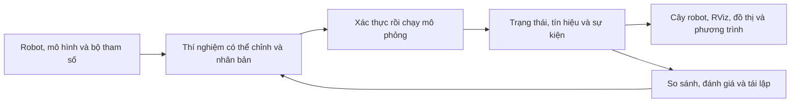

# Kế hoạch hoàn thiện nền tảng mô phỏng DUK

**Đề xuất phát triển cho nhánh `codex/duk-simulation-workbench` tại `bd9b402`, ngày 19/11/2026.** Bản kế hoạch xác định phạm vi tính năng cần xây từ các yêu cầu gốc. Giá trị vật lý, thiết kế controller, hợp đồng triển khai và tiêu chí an toàn của robot thật do dự án xác lập qua công việc kỹ thuật riêng. [Yêu cầu gốc](codex://threads/01a1ed6e-0656-7dd3-b20c-6c78922ef5dd) · [Kế hoạch phiên trước](codex://threads/01a1ed90-ec72-7652-bf49-ed0ae2a1118b)

[Thiết kế chi tiết](simulation-platform-design.md) xác định cách ghép thuật toán, vòng chạy, dữ liệu, không gian làm việc và các cổng tích hợp.

## Nền tảng phải làm được gì

Mở DUK thấy toàn robot 3D. Chọn **một khớp, một khâu, một bánh, một chân, thân hoặc toàn robot** để xem cấu tạo, tọa độ, phương trình và giới hạn. Từ đó có thể lập bài thử tĩnh, đặt quỹ đạo, chạy động lực học hở vòng hoặc đóng vòng với bộ điều khiển. Chọn điều kiện chỉ thay đổi ở một bánh, thay tải mang, đặt các cú đẩy, ra lệnh tiến/quay/nâng/hạ, tạo lỗi cảm biến hoặc trễ lệnh theo thời gian. Sau khi chạy, có thể lần từ ý định điều khiển đến chuyển động và lực của bộ phận đang chọn. Lưu, sửa, nhân bản và so sánh toàn bộ thí nghiệm ngay trong cùng dự án mô phỏng.

Thiết kế xoay quanh **một thí nghiệm có thể tạo mới, kiểm tra, chạy, phân tích và tái lập**. NB1–NB6 là nhóm mô hình và bài thử mẫu mở từ cùng không gian làm việc. Mỗi mô hình giữ miền áp dụng riêng. Chẳng hạn, NB4 phù hợp để khảo sát cân bằng dọc với hông cố định, NB6 mới mang tư thế không gian, bốn cơ cấu chấp hành và tiếp xúc riêng từng bánh. Cùng một dự án có thể dùng cả hai để trả lời các câu hỏi khác nhau. [Các bài nghiên cứu hiện có](../../robot/software/core/README.md#duk-v3-research-notebooks) · [Sổ tay DUK v3](https://app.notion.com/p/4131f3cc033281a4b73dcdb38ed41514)

| Việc cần làm trong dự án | Một luồng hoàn chỉnh phải cho phép |
| --- | --- |
| Khảo sát cơ khí | Chọn chân trái và một khớp. Đặt góc, tốc độ và gia tốc, quét miền góc, tìm IK cho tâm bánh. Xem nhánh lắp, kỳ dị, bất biến BCO, Jacobian, khả năng chịu tải và mô-men dự trữ. Lấy tư thế hợp lệ làm ứng viên điều kiện đầu cho bài thử động. |
| Kiểm toàn robot | Tạo thí nghiệm từ trống hoặc từ mẫu. Chọn tư thế và vận tốc ban đầu, điều kiện hai bánh, tải, quỹ đạo và lệnh. Chạy từ đầu, tạm dừng ở mốc tính, bước tiếp hoặc phát lại. Chọn bánh, hông hoặc thân trên cùng kết quả để truy nguyên phản ứng. |
| Thử điều khiển | Ghép cảm biến mô phỏng, bộ ước lượng, tham chiếu, điều khiển và giới hạn phù hợp. Dùng cùng plant, môi trường và seed để thay thuật toán hoặc thứ tự ưu tiên. Biết rõ điều gì thay đổi và điều gì được luồng tính thực sự sử dụng. |
| Tìm nguyên nhân sai | Dựng các biến thể chỉ đổi một điều kiện hoặc một nhóm có chủ đích. Xem trước/sau sự kiện và theo dõi từ yêu cầu, phản hồi, nghiệm bộ điều khiển, giới hạn lệnh tới trạng thái và tiếp xúc của robot. Phân biệt lỗi mô hình, cấu hình, số học, bộ điều khiển, dữ liệu và hiển thị. |
| Chứng minh kết quả | Chọn chỉ số và ngưỡng trước khi chạy. Chạy nhiều cấu hình và seed, lưu cả ca thất bại. Mở kết quả và tái lập bằng Qt, CLI hoặc notebook. Đối chiếu theo từng tầng với Gazebo động và sau đó với dữ liệu vật lý khi có. |

## Vì sao bản hiện tại chưa đáp ứng

| Năng lực | Bản hiện tại làm được | Khoảng thiếu chặn sử dụng |
| --- | --- | --- |
| Tạo thí nghiệm | Chọn bài NB và chỉnh trường có sẵn. Python và Qt dùng chung phần lớn lõi nghiên cứu. | Chưa dựng được chuỗi thao tác tùy chọn gồm nhiều lệnh, sự kiện và lỗi theo từng đối tượng. Workbench nhận danh sách trường cố định theo bài. |
| Ghép thuật toán | Chọn vài controller và feedback cho từng bài. NB6 có QP/HQP và hai chính sách ưu tiên. | Chưa nhìn hoặc thay được các khâu theo vai trò, chưa có kiểm kết nối từ đầu và chẩn đoán khâu nào đọc tín hiệu gì. Chọn controller từ danh sách mới thay được nhánh đã viết sẵn. |
| Làm việc theo cấp robot | Có FK/IK, tải hông, hình học, cây bộ phận và một phần ma trận tại mẫu. | Khảo sát riêng bộ phận và phân tích bộ phận trong ca toàn thân còn rời nhau. Thiếu chuyển cấu hình có kiểm tra, phép kích thích riêng cơ cấu và đường truy nguyên từ lệnh đến phản lực. |
| Điều khiển mô phỏng | Chạy trọn ca ở worker rồi seek/phát dữ liệu đã tính. | Chưa có pause/step của bộ tích phân, điều khiển đang mô phỏng, lưu trạng thái đầy đủ để tiếp tục hoặc tách nhánh. Phát từng mẫu kết quả đã ghi chỉ đáp ứng nhu cầu xem lại. |
| Thí nghiệm và đánh giá | Có chồng hai ca, tệp kết quả và tái chạy trong dung sai. Notebook có các bài quét chuyên biệt. | Chưa có nơi xác định ma trận thử, chỉ số và quy tắc đạt, chạy hàng loạt, sắp xếp kết quả hoặc truy ngược từ một điểm trên bản đồ kết quả về ca gốc. |
| Môi trường và độ tin cậy | Có lăn/trượt/bay ở nghiên cứu phẳng, hai mặt đỡ ngang trong NB6, tham số tổng hợp và preview Gazebo tĩnh. | Chưa dựng địa hình/va chạm và tải ngoài tổng quát trong ca toàn thân, chưa đối chiếu động lực học Gazebo hoặc dữ liệu thật. |
| Một sản phẩm | Qt, RViz, Web, CLI và notebook đều có đầu vào hoặc đầu ra riêng. | Còn lệch vòng đời ca, định dạng tệp, nguồn trạng thái và chức năng. Kết quả mở ở nơi khác khó tiếp tục sử dụng đủ ngữ cảnh. |

Đã kiểm tại cửa vào `Workbench.run`. Các đầu vào thử cho lịch lệnh/sự kiện, trạng thái đầu tùy ý, lực ngoài và trễ cơ cấu chấp hành bị từ chối ở NB6. Các phép thử tương ứng cho quỹ đạo nhiều điểm ở NB1–NB2, mặt đỡ lệch ở NB3, thời lượng ở NB4 và góc đích riêng từng bên ở NB5 cũng bị từ chối. Những tên trường thử chỉ dùng để kiểm lỗ hổng năng lực. Đọc luồng hiện hành xác nhận NB6 nhận một lần đổi μ, một lần biến thiên vận tốc tức thời và một cửa sổ lỗi, với tham chiếu sinh từ các công thức cố định trong mã. [Ràng buộc đầu vào](https://github.com/anmh1205/duk/blob/bd9b40286ac29da8ba6e3b88e0b8d81f4599096f/applications/operator-dashboard/workbench/inputs.py#L56) · [Chọn bài thử](https://github.com/anmh1205/duk/blob/bd9b40286ac29da8ba6e3b88e0b8d81f4599096f/applications/operator-dashboard/workbench/session.py#L69) · [Vòng chạy NB6](https://github.com/anmh1205/duk/blob/bd9b40286ac29da8ba6e3b88e0b8d81f4599096f/robot/software/core/src/duk_core/simulation/whole_body.py#L186) · [Tham chiếu NB6](https://github.com/anmh1205/duk/blob/bd9b40286ac29da8ba6e3b88e0b8d81f4599096f/robot/software/core/src/duk_core/simulation/_whole_body_tasks.py#L54)

## Các phần tạo thành một nền tảng thống nhất

| Phần | Trách nhiệm | Liên kết với phần còn lại |
| --- | --- | --- |
| **Robot và mô hình** | Một cây bộ phận có định danh ổn định, hình học chuẩn, hệ tọa độ, khớp, cơ cấu chấp hành, cảm biến và bộ tham số có nguồn. Mỗi mô hình công bố nó mô tả được các đối tượng, đầu vào, đầu ra và điều kiện nào. | Chọn bánh trái trong 3D, bộ đặt điều kiện hoặc bảng lực đều chỉ cùng đối tượng. Mỗi mô hình có ánh xạ riêng tới đối tượng chung. |
| **Thí nghiệm** | Lưu mô hình/phiên bản, trạng thái đầu, môi trường, chuỗi lệnh, nhiễu/lỗi, các khối thuật toán, chu kỳ, điều kiện dừng, tín hiệu cần ghi và tiêu chí đánh giá. Mẫu có thể được mở và chỉnh như thí nghiệm thường. | Cùng cấu hình có thể chạy từ Qt, CLI và notebook. Sau khi xác thực, runner nhận đúng đầu vào đã giải quyết. Kết quả chỉ tới phiên bản thí nghiệm đã chạy. |
| **Mô phỏng và thuật toán** | Bộ chạy quản lý đồng hồ mô phỏng, trạng thái, lịch sự kiện, đường phản hồi và tích phân. Core sở hữu phương trình, thuật toán và phép tính. Mỗi môi trường mô phỏng vận hành theo khả năng đã xác nhận. | Đầu vào mới đi qua cùng đường với ca mẫu. Mỗi bước tạo trạng thái, tín hiệu, nhật ký lệnh và sự kiện để các công cụ dùng chung. |
| **Kết quả và kiểm chứng** | Bản ghi bất biến của một lần chạy. Lưu trạng thái, tín hiệu, chỉ số, sự kiện, nguồn dữ liệu và điều kiện kết thúc. So sánh từng ca hoặc cả tập ca bằng cấu hình truy nguyên được. | Inspector, RViz, đồ thị, bảng, CLI, CSV và báo cáo đọc cùng kết quả. Kiểm tra tái lập, sai lệch với mô hình tham chiếu và dữ liệu đo dùng cùng định nghĩa tín hiệu. |
| **Không gian làm việc** | Mở dự án trong Qt với robot 3D, cây đối tượng, vùng thiết lập, chế độ chạy, phân tích và thư viện thí nghiệm. RViz là bề mặt xem rô-bốt và lực. Web nhẹ dùng dữ liệu chung cho chức năng thực sự hỗ trợ. | UI kết nối vào một trạng thái ca đang làm và một kết quả đang xem. Vùng làm việc chọn được kết quả, mẫu, đối tượng và chế độ tính/phát đang hiệu lực. |

Nhánh phân tích có thể quay lại tạo một biến thể mới. Vòng phản hồi điều khiển bên trong mỗi lần chạy nhận cảm biến từ plant, ước lượng trạng thái, tạo lệnh, giới hạn lệnh và tích phân bước tiếp theo. Bộ chạy phải giữ hai luồng thời gian này rõ ràng. Chỉnh bản nháp tác động đến lần chạy tiếp theo. Can thiệp khi mô phỏng đang chạy là sự kiện được ghi và phát lại theo đồng hồ mô phỏng. [Luồng điều khiển DUK v3](https://app.notion.com/p/4131f3cc03328156af1dc6b76714fce1)

Trong không gian làm việc, **Robot và mô hình** quản lý đối tượng, phương trình và hồ sơ. **Kịch bản** gắn điều kiện, quỹ đạo và các sự kiện vào đối tượng. **Điều khiển** cấu hình các khâu thuật toán. **Chạy** quản lý tiến trình mô phỏng. **Phân tích** đồng bộ mẫu giữa đồ thị, phương trình và 3D. **Thí nghiệm** tổ chức biến thể, batch và tiêu chí. Chuyển giữa các vùng này giữ nguyên dự án, ca và đối tượng đang chọn. Cơ cấu trái/phải, tọa độ và dữ liệu gắn với cùng nguồn đến khi mô hình cụ thể yêu cầu một phép ánh xạ đã kiểm.

## Danh mục tính năng cần xây

### 1. Robot, động học, động lực học và toán học

| Cấp đối tượng | Điều khiển hoặc khảo sát | Cần xem và kiểm |
| --- | --- | --- |
| **Khớp và cơ cấu chấp hành** | Chọn tọa độ, chiều dấu, đặt tư thế hoặc dãy $q, \dot q, \ddot q$. Trong mô hình động phù hợp, thử mô-men riêng từng hông/bánh hoặc bộ bám quỹ đạo. Chọn giới hạn hành trình và hồ sơ cơ cấu chấp hành được cung cấp. | Giá trị đặt và thực, mô-men yêu cầu/giới hạn/áp dụng, truy nguyên tác động của mô-men lên tọa độ tổng quát, vùng bão hòa, tốc độ, dự trữ và công suất khi mô hình hỗ trợ. |
| **Khâu và cơ cấu bốn khâu** | Chọn AB, BC, CD, cụm BCO và điểm A/B/C/D/H/O. Quét góc, thử IK, quỹ đạo nhiều mốc, đưa tải ngoại lực lên điểm khảo sát có quy ước đã định. | Hướng và chiều dài, workspace, nhánh lắp, vùng kỳ dị, bất biến/khép vòng, Jacobian và đạo hàm bậc hai. Hiển thị phép kiểm sai phân độc lập và tác động tải lên cơ cấu hông. |
| **Một chân, hai chân** | Đặt góc và quỹ đạo độc lập. Chọn hệ chân/thân/thế giới và tư thế hoặc điều kiện mặt đỡ tương thích. Dùng kết quả FK/IK làm ứng viên trạng thái đầu hoặc quỹ đạo đặt. | Đường tâm bánh, vận tốc, gia tốc, độ cao và roll thân, clearance hai bánh, mô-men hông từ tải, miền cho phép. Khi đưa tư thế tĩnh sang động lực học, kiểm lại trạng thái, vận tốc và điều kiện tiếp xúc. |
| **Bánh và tiếp xúc** | Thay độ bám, điều kiện mặt đỡ, tải, profile contact hoặc lệnh bánh theo mô hình. Dựng trường hợp bám, trượt, nhấc và chạm lại. | Vòng quay và quy ước spin, trượt dọc/ngang, khe hở, lực pháp tuyến/tiếp tuyến, mức sử dụng bám, điểm tác dụng, chế độ và sự kiện. Phân biệt lực contact solver cấp, lực quan sát, lực ước lượng và phản lực lăn cứng yêu cầu. |
| **Thân và toàn robot** | Thay CoM, quán tính, tải và vị trí tải bằng hồ sơ có nguồn. Đặt pose và vận tốc ban đầu, thời lượng, bước và luật tiếp xúc. Chạy hở vòng hoặc vòng kín trong giới hạn từng mô hình. | Pose thân, CoM, lực từng bánh, tín hiệu bốn motor, năng lượng/công suất ở mô hình hỗ trợ và điều kiện dừng. Có ma trận khối lượng, lực suy rộng, ma trận chấp hành, Jacobian contact, phần dư động lực học và ảnh hưởng lên từng khớp. |

Phân biệt **đặt chuyển động** và **đặt mô-men**. Ví dụ trong NB5, góc hông theo quỹ đạo đặt và mô-men hông là kết quả cần để thực hiện giả thiết đó. Muốn thử hông bị bão hòa rồi lệch quỹ đạo cần mô hình động nhận lệnh hông, như trong bài thử không gian phù hợp. Mỗi màn phương trình ghi dạng phương trình, nguồn tham số, thứ tự biến, quan hệ hình học, hệ trục và phép kiểm đối chiếu. Chỉ rõ dữ liệu nào ghi lúc chạy và dữ liệu nào tính lại. [Động học workbench](../../applications/operator-dashboard/workbench/kinematics.py) · [Các tầng mô hình](../theory/modeling.md) · [NB5](../../robot/software/core/src/duk_core/simulation/height.py)

### 2. Trình dựng điều kiện và kịch bản

- **Trạng thái đầu.** Chọn tư thế hợp lệ từ hình học, đặt thân và từng khớp trong miền mô hình, chọn vận tốc, nguồn trạng thái và contact ban đầu. Có phép kiểm khép vòng, pose mặt đỡ, đơn vị, chiều dấu và trạng thái khả thi. Cho so đầu vào chưa chạy với trạng thái đầu đã áp dụng.
- **Môi trường.** Cấu hình từng bề mặt hoặc từng bánh theo khả năng mô hình. Có nền ngang, lệch cao độ, vùng đổi ma sát, dốc và vật cản/địa hình khi backend có mặt đỡ và luật contact tương ứng. Xem bề mặt đang mô phỏng ở 3D, nguồn/giá trị contact, và vị trí sự kiện trên thế giới.
- **Lịch chuyển động.** Tạo nhiều đoạn giữ, tăng/giảm, tiến/lùi, dừng, quay, nâng/hạ, nhún, giữ ngang, neo vị trí/hướng. Mỗi nhiệm vụ có mốc bật/tắt độc lập. Hỗ trợ chỉnh điểm quỹ đạo và các đại lượng chỉ định, kèm quy tắc nội suy có ghi rõ.
- **Lực và sự cố.** Đặt nhiều tác động, chọn thời điểm, thời lượng, vị trí, hệ trục và đối tượng. Trên mô hình hỗ trợ, cho thử lực/mô-men theo thời gian, bước thay đổi ma sát, trễ lệnh, suy giảm chấp hành, nhiễu/bias, mất mẫu cảm biến, deadline và vô nghiệm. Một thay đổi vận tốc tức thời mang tên riêng để phân biệt với tác dụng lực kéo dài.
- **Sự kiện.** Thêm/bớt, sắp xếp, xem xung đột và thứ tự áp dụng ở cùng mốc. Ghi thời gian yêu cầu và thực tế, tick tác động, nơi tác động và lý do bỏ qua. NB3 và NB6 hiện có cách áp mốc khác nhau, trình dựng phải thể hiện theo mô hình. Sau lịch theo thời gian mới bổ sung kích hoạt theo điều kiện như mất tiếp xúc hoặc đi qua vùng nền nếu luật kích hoạt đã có phép kiểm.
- **Quản lý phiên bản.** Tạo từ trống, từ mẫu, từ ca đã chạy hoặc từ biến thể. So cấu hình, khóa biến nào phải giữ trong phép thử, lưu nháp và mở lại. Các hồ sơ, kịch bản và kết quả tham chiếu cùng phiên bản robot. [Bộ tham số DUK](../../robot/config/physical/README.md) · [Kịch bản và quyền sở hữu](../architecture/repository-layout.md#ownership-boundaries)

### 3. Ghép cảm biến, ước lượng và điều khiển

Người dùng chọn và thay từng khâu có vai trò rõ ràng **tham chiếu → đo/ước lượng → điều khiển nhiệm vụ → phân bổ lệnh → giới hạn/giám sát → cơ cấu chấp hành**. Plant nhận lệnh rồi xuất trạng thái và tín hiệu mô phỏng để đóng vòng. Với mỗi khâu, thấy được tín hiệu nó nhận và phát, đơn vị, hệ tọa độ, dấu, thứ tự kênh, chu kỳ và giả thiết. Kiểm từ đầu và báo chính xác chỗ ghép sai. Cho dùng kênh từ plant làm đối chứng, đánh dấu rõ lúc nó được đưa vào bộ điều khiển.

Ví dụ, chọn trạng thái mô hình hoặc odometry/ước lượng để so NB4. Trong NB6, chọn các tham chiếu đồng thời và đánh giá cân bằng trước hay chân trước trong miền cả hai chính sách được định nghĩa. LQR NB4 phát mô-men gộp của hai bánh, còn plant NB6 có bốn kênh. Một bộ điều khiển mới phải ghép qua các vai trò và phép chuyển đổi có ý nghĩa vật lý đã được kiểm. Có thể bắt đầu với các khâu hiện có trong core và lớp kiểm tương thích, rồi mở đăng ký cấu hình thuật toán để thực hiện các thí nghiệm mới qua cùng đường chạy. [Ranh giới trong core](../software/core.md) · [Vòng phản hồi toàn thân](https://app.notion.com/p/4131f3cc03328156af1dc6b76714fce1)

| Năng lực | Đầu ra bắt buộc |
| --- | --- |
| Cảm biến và ước lượng | Tín hiệu mô hình, tín hiệu đo giả lập, timestamp đo/nhận/dùng, độ tin cậy và kết quả ước lượng. Có ca mất cảm biến, trượt và sai μ. Mỗi tín hiệu chỉ rõ nguồn và thứ tự thông tin mà thuật toán được biết. |
| Tham chiếu và ưu tiên | Yêu cầu, hiệu lực, thực đo/mô phỏng, sai số, task đang ON, mức thực hiện và lý do giới hạn. Theo dõi chuyển trạng thái Enter/Active/Limited/Paused/Exit khi bật tắt. |
| Lệnh và giám sát | Có số lệnh trước và sau giới hạn, lệnh thực sự phát vào plant, tải và ràng buộc chi phối, lệnh dự phòng/dừng và lý do. Thời gian tính, phần dư và hạn định được lưu bằng các đại lượng riêng. |
| Tuning và đối chiếu | Cho thay gain/trọng số/giới hạn trong miền thuật toán chấp nhận và ghi phiên bản thay đổi. Hiện ma trận tuyến tính, gain và hướng tác động của ràng buộc. Báo điều kiện khác giữa hai ca trước khi đánh giá thuật toán. |

### 4. Chạy, can thiệp và phát lại

| Chế độ | Hành vi phải có |
| --- | --- |
| **Chạy theo kịch bản** | Xác thực, chạy tới thời lượng/điều kiện dừng, hiển thị tiến trình theo thời gian mô phỏng và lý do kết thúc. Lưu cả ca dừng sớm và kết quả từng phần nếu được đánh dấu đúng. Ưu tiên chế độ này để có thí nghiệm lặp được. |
| **Điều khiển khi mô phỏng** | Tiến tới mốc, pause, bước mẫu hoặc tiếp tục. Nhập lệnh hoặc áp sự kiện mới vào mô phỏng, ghi mốc dự kiến/thực tế và nguồn lệnh. Cơ chế chạy tương tác cần dùng cùng thứ tự cập nhật và lõi với chạy kịch bản. |
| **Phát lại** | Duyệt dữ liệu đã tính, bước mẫu, nhập mốc, nhảy sự kiện, điều chỉnh tốc độ phát. Đồ thị, inspector và RViz tham chiếu cùng ca/mốc. Mẫu thiếu, terminal và nguồn thời gian được chỉ ra. |
| **Thử biến thể từ cùng xuất phát** | Nhân bản thí nghiệm và thay một hoặc nhiều yếu tố có chủ đích. Bước đầu tái chạy từ đầu với cấu hình nguồn. Tách nhánh giữa ca sau khi cơ chế lưu trạng thái đầy đủ qua được phép thử tiếp tục không đổi đầu vào. |
| **Chạy hàng loạt** | Tạo ma trận thử theo thông số, thuật toán, môi trường và seed. Xếp hàng, hủy, lưu manifest và trace phù hợp. Lọc theo kết quả/nguyên nhân dừng rồi mở đúng ca và sự kiện từ bảng tổng hợp. |

Để tiếp tục đúng từ mô phỏng giữa ca, pose 3D và các góc khớp chỉ là một phần trạng thái. Phải giữ vận tốc, đồng hồ/lịch sự kiện, trạng thái cảm biến và ước lượng, bộ sinh nhiễu, hàng lệnh trễ, pha tham chiếu/điểm neo, bộ giám sát, contact và trạng thái bộ giải theo mô hình. Phép kiểm cốt lõi là một ca chạy liền và một ca pause/tiếp tục với đầu vào không đổi cho thông tin tương đương theo tiêu chí đã định. Tách nhánh dùng cùng điều kiện tới mốc tách rồi chỉ thay các yếu tố đã khai báo. [Trạng thái trong vòng NB6](https://github.com/anmh1205/duk/blob/bd9b40286ac29da8ba6e3b88e0b8d81f4599096f/robot/software/core/src/duk_core/simulation/whole_body.py#L207) · [Ví dụ phạm vi trạng thái để tái lập trong MuJoCo](https://mujoco.readthedocs.io/en/3.8.0/computation.html#reproducibility)

### 5. Quan sát, giải thích và quyết định trên kết quả

- **Duyệt theo đối tượng và đồng hồ chung.** Chọn bộ phận từ cây hoặc viewer, highlight trong 3D và mở đúng bộ đại lượng. Chọn sự kiện thì tới mẫu tương ứng. Biểu đồ giữ cùng con trỏ khi chuyển sang bánh khác, hông hoặc thân. Xem hai bánh và trạng thái toàn thân đồng thời quanh mốc gây lỗi.
- **Kết quả theo đường đi của lệnh.** Xem nhóm tham chiếu, ước lượng, biến điều khiển, giới hạn, phản lực, chuyển động và chỉ số. Có đồ thị nhiều kênh, đường giới hạn, phần dư, vectơ lực/CoM, quỹ đạo 2D, điểm đạt/hỏng, sai số và bảng số tại mẫu. Mỗi tín hiệu mang nguồn, đơn vị, hệ trục, thành phần và thời điểm có nghĩa. Đơn vị khác có trục phù hợp. Các điều kiện rời rạc có biểu diễn theo bậc và mẫu thiếu hiện đúng.
- **So sánh và truy nguyên.** Chồng hoặc đặt cạnh nhiều ca. So tuyệt đối theo đồng hồ hoặc căn theo sự kiện cùng loại có ghi mốc gốc. Các ca dừng khác nhau chỉ cung cấp dữ liệu trong miền của từng ca. Nhận diện ca và đúng tham số từ kết quả. Thêm đánh giá sai số bám, góc/độ trượt đỉnh, lực cực tiểu, thời gian bão hòa/phục hồi, phần dư và thời gian giải theo mục đích từng bài.
- **Thư viện kết quả.** Lưu id, cấu hình đã áp dụng, mô hình và phụ thuộc, nguồn tham số/geometry, revision hoặc snapshot, seed, sự kiện, trạng thái kết thúc, tín hiệu và phép kiểm. Mở lại độc lập, gắn hồ sơ gốc, xuất dữ liệu bảng và chạy lại từ bản nguồn. Sử dụng manifest của notebook và record Qt làm cơ sở cho định dạng dùng chung.
- **Trình bày theo yêu cầu gốc.** Tên và phản hồi tiếng Việt, thuật ngữ và ký hiệu nhất quán. Số thập phân trên bảng, biểu đồ và 3D, có cách đọc số rất nhỏ và đơn vị. Dữ liệu xuất giữ độ chính xác. **Chạy**, **pause mô phỏng**, **phát lại** và **hủy job** là các hành động có trạng thái riêng. Một thao tác bị chặn phải cho biết thiếu đầu vào, mô hình hoặc bằng chứng gì. [Kiểm chứng trong sổ tay DUK v3](https://app.notion.com/p/4131f3cc0332811da657f1bbb15cb66b) · [Rà soát các nút và bố cục hiện tại](simulation-workbench-audit.md#rà-soát-từng-nút-và-trạng-thái-giao-diện)

### 6. Gazebo, thế giới 3D và đường tới robot thật

- **Python và RViz.** Dùng core để làm nghiên cứu có thể chạy headless và kiểm toán phương trình. Dùng RViz để phát pose, tình trạng contact, lực và các đại lượng chung qua ROS. RViz dùng cây hiển thị được dựng từ nghiệm động học, còn mô hình cơ học cần kiểm ràng buộc khép vòng trong bộ giải. [Bench động học](kinematic-bench.md#geometry-and-ros-ownership)
- **Gazebo động.** Tạo ca kiểm chứng một cơ cấu khép kín, joints, collision, ma sát và quán tính trên engine/version dự kiến, rồi mở rộng tới hai chân và thân. Thân và cơ cấu trong Gazebo phải có physics, nhận lệnh và tạo trạng thái/cảm biến. Dùng chung định danh, lệnh, clock, frame và dữ liệu đầu vào trong phần giao nhau với Python. Đối chiếu theo thứ tự hình học → tải tĩnh → quỹ đạo đặt → lăn/trượt/va chạm → vòng kín. Ghi chênh lệch còn lại do giả thiết solver/contact trước khi mở dốc, bậc nền và vật cản. [Preview đã có](simulation-preview.md) · [Điều khiển world trong Gazebo Harmonic](https://gazebosim.org/docs/harmonic/gui/#world-control) · [Kết nối ROS và Gazebo](https://gazebosim.org/docs/harmonic/ros2_integration/)
- **Dữ liệu vật lý và kiểm chứng.** Phân biệt hình học đã cấu hình, số tổng hợp và số nhận dạng. Đưa CAD, CoM/quán tính, truyền động, đường bao cơ–điện, độ trễ, cảm biến, lốp/mặt nền, điện và nhiệt vào khi có nguồn. So với dữ liệu đo độc lập và ghi miền áp dụng. Nhập log để xem/so sánh tách biệt với việc điều khiển thiết bị thật. Công việc trên phần cứng tuân theo quyết định và ủy quyền riêng. [Tham số vật lý](../../robot/config/physical/README.md) · [Các phép kiểm mô hình và thực nghiệm](https://app.notion.com/p/4131f3cc033281a2bb8ce96f5a697350)

### 7. Vận hành dự án và sử dụng lâu dài

- **Mở và chia sẻ dự án.** Có lệnh khởi động chuẩn, kiểm phiên bản và khả năng của backend, ví dụ có Python headless hoặc có ROS/renderer. Mở dự án, hồ sơ, mô hình và ca từ cùng thư viện. Đóng gói một thí nghiệm cùng nguồn cần thiết, kiểm liên kết/hash, xem kết quả khi chỉ có dữ liệu đã lưu. Hỗ trợ nâng phiên bản định dạng và thông báo lỗi chính xác khi thiếu phần phụ thuộc.
- **Trạng thái và phục hồi.** Lưu nháp, khôi phục sau lỗi, hủy tính và quản lý kết quả từng phần. Mở nhiều ca để đối chiếu với nguồn rõ. Phục hồi sau khi viewer tắt, bộ giải lỗi hay tệp không còn tương thích. Cung cấp log và vị trí lần lỗi để tái hiện thay vì chỉ báo thất bại.
- **Tự động hóa và mở rộng.** Lệnh headless đọc và kiểm đúng kịch bản của Qt. Người phát triển thêm mô hình, khâu thuật toán, tín hiệu, world hoặc chỉ số bằng cơ chế có tài liệu và phép kiểm. Một tính năng mới xuất hiện ở nơi tương thích trong nền tảng, có ví dụ tối thiểu và ca hồi quy.
- **Hiệu năng và trải nghiệm.** Đo thời gian mở, thời gian chạy, RAM và độ trễ seek trên các ca đại diện. Nêu rõ cách ghi mẫu, giảm mẫu hiển thị và điều kiện mất dữ liệu. Kiểm kiểu chữ, tiếng Việt, phím tắt, thông báo, kích thước màn hình và bố cục khi có 3D. Kiểm ít nhất một hành trình đầy đủ từ tạo ca đến mở lại trên môi trường được công bố. [Môi trường dự án](../../environment/README.md) · [Bằng chứng giao diện hiện tại](simulation-workbench-audit.md#rà-soát-từng-nút-và-trạng-thái-giao-diện)

## Phân vai để tránh các ứng dụng rời nhau

| Thành phần | Việc cần giao đúng chỗ |
| --- | --- |
| `duk_core` | Toán học, mô hình, sensor/estimation, điều khiển, tích phân, logic thí nghiệm và chỉ số dùng lại. Tiến tới phép chạy từng bước ở các mô hình cần chạy tương tác. Chạy trước không phụ thuộc GUI/ROS. |
| `robot/config`, `robot/simulation` | Nguồn hồ sơ robot, kịch bản, thế giới và dữ liệu định nghĩa theo sở hữu repo. Tham số vật lý có nguồn và trạng thái xác nhận. |
| Qt của operator-dashboard | Chủ phiên làm việc về mô hình, kịch bản, ghép thuật toán, chạy, phân tích và quản lý kết quả. Các hành động gọi các khả năng đã được kiểm ở tầng dùng chung. |
| `duk_description`, RViz, `duk_gazebo` | Cấu hình hiển thị, trạng thái ROS, TF, marker, bridge và thực thi mô phỏng Gazebo. Từng backend công bố khả năng hỗ trợ để thí nghiệm dùng đúng. |
| CLI, notebook và Web | CLI chạy và đánh giá lặp được. Notebook giải thích và nghiên cứu từ cùng API/kết quả. Web có thể giữ lối xem/thử cục bộ với những tính năng đã kết nối qua cùng hợp đồng. |
| `research`, `tests`, `data` | Kịch bản nghiệm thu/benchmark có mục tiêu và phép kiểm, test theo tầng, manifest và kết quả có nguồn. Tổ chức theo sở hữu hiện hành của repo. |

Quyết định còn mở gồm cách nhúng/xếp cửa sổ RViz, nơi định nghĩa hợp đồng định kiểu, biểu diễn lịch và snapshot, phạm vi thực thi Gazebo, ngưỡng chấp nhận và bộ dữ liệu chuẩn. Chọn sau khi thử đường chạy đầu tiên và truy lại được dữ liệu. [Sơ đồ sở hữu repo](../architecture/repository-layout.md#ownership-boundaries)

## Lộ trình xây và điểm nghiệm thu

Mỗi mốc đưa vào một luồng kỹ thuật có thể sử dụng với đầu vào do người dùng tạo. Những lỗi bảng số, viewer cũ, trạng thái nhầm ca và tệp sai format được sửa trong luồng liên quan để kiểm được kết quả.

| Mốc | Bàn giao chức năng | Kiểm từ đầu tới cuối |
| --- | --- | --- |
| **1. Tạo và chạy một dự án mô phỏng** | Cây robot, danh mục khả năng mô hình, một thí nghiệm được chỉnh và lưu, một đường xác thực/chạy/kết quả dùng chung Qt và CLI. Làm đường tương thích với mẫu NB hiện có. | Tạo ca từ trống, chọn mô hình, điều kiện hợp lệ, chạy, mở kết quả và đọc đúng một mẫu ở Qt/RViz. Tái chạy từ CLI và kiểm nguồn tương ứng. Cấu hình ghép sai có lỗi rõ trước khi chạy. |
| **2. Từ một bộ phận lên toàn robot** | Khảo sát khớp–khâu–chân–bánh–thân, quỹ đạo nhiều mốc, tải tĩnh, chạy động và bộ phân tích toán. Chuyển được tư thế/quỹ đạo giữa bài tương thích. | Dựng tư thế hai bên khác nhau, lấy từ IK hoặc đặt góc, khảo sát tải, đưa tư thế hợp lệ vào bài chạy động. Truy ngược từ chuyển động của bánh đến q, lực, mô-men và phương trình ở cùng mẫu. |
| **3. Dựng kịch bản và ghép vòng điều khiển** | Lịch lệnh và nhiều sự kiện, lựa chọn cảm biến/ước lượng/controller/giới hạn, trạng thái ban đầu và môi trường theo từng mô hình. Tham chiếu và nhiệm vụ điều khiển đi qua đường cấu hình chung. | Tạo ca tiến–quay–dừng–đổi chiều cao, thay điều kiện riêng từng bánh và tiêm lỗi. Chạy hai cấu hình thuật toán tương thích cùng điều kiện. Đọc được lúc mô hình nhận từng lệnh, task bị giảm và nguyên nhân. |
| **4. Vận hành và gỡ lỗi thí nghiệm** | Pause/step/chạy tiếp, phát lại đồng bộ, can thiệp và lưu event, đồ thị đa kênh, phân tích cả ca, xem nguyên nhân dừng. Mở lại đủ ngữ cảnh, sau đó bổ sung snapshot và nhánh giữa ca khi đạt phép kiểm tiếp tục. | Chạy liền và pause/tiếp tục cùng mô hình. Kiểm sự kiện lệch tick, mẫu cuối, lỗi cảm biến/solver, mô phỏng dừng sớm, viewer thiếu pose, ca so sánh khác độ dài và tệp sai phiên bản. |
| **5. So sánh và kiểm chứng có hệ thống** | Ma trận thí nghiệm, batch, tiêu chí, đồ thị độ nhạy và báo cáo truy nguyên. Thêm bộ test phương trình, hội tụ, khác nhau giữa controller và lỗi tích hợp. Kiểm UX luồng đầy đủ. | Từ một bộ biến thể, chạy sweep, giữ cả ca fail, chọn báo cáo và mở trace bất kỳ theo id. Một checkout sạch tái lập ca được chỉ định với đầu vào hợp lệ. |
| **6. Gazebo động và địa hình** | Backend Gazebo chạy plant động, mô hình tiếp xúc và thế giới, bridge lệnh/trạng thái, kiểm liên thông và đối chiếu với Python. Dốc và địa hình có mô hình phù hợp. | Cùng thí nghiệm có ý nghĩa vật lý chạy ở hai backend trong miền giao nhau. Xem sai khác từ khép vòng đến vòng kín và lần được nguồn. |
| **7. Bằng chứng vật lý và mở rộng** | Hồ sơ đo có nguồn, nhập/replay log, hiệu chuẩn, mô hình tải/truyền động/điện/nhiệt theo dữ liệu, chuẩn bị tích hợp runtime. Hỗ trợ thêm mô hình, tín hiệu và khâu thuật toán qua cùng giao diện vận hành. | Một thuật toán mới hoặc mô hình mới đi qua được các bước cấu hình, xác thực, chạy, so sánh và tái lập. Các phép kiểm vật lý theo ngưỡng và quy trình của dự án. |

### Bộ ca nghiệm thu nền tảng

1. **Khớp đến chân.** Dựng từ trống một bài khảo sát với hai hông khác góc, chọn thanh và điểm, thử IK với điểm đạt được và không đạt được, quét tải qua vùng bão hòa. Lưu kết quả rồi dùng tư thế hợp lệ trong một bài động.
2. **Điều khiển toàn thân.** Tạo chuỗi nhiều đoạn tiến/lùi/quay/nâng/hạ, bật tắt giữ ngang và neo độc lập. Thêm đổi bám, nhiễu lực và lỗi tại những mốc khác nhau. Mở đúng mẫu và đọc luồng yêu cầu → tham chiếu hiệu lực → lệnh → chuyển động → tiếp xúc.
3. **Thay một khâu.** Giữ cùng mô hình, môi trường, trạng thái đầu, seed và chu kỳ, thay một observer hoặc controller được hỗ trợ. Hiện khác biệt trong cấu hình, tín hiệu và chỉ số. Một tổ hợp ghép sai mô hình hoặc đơn vị bị chặn có lý do.
4. **Kiểm biên và tái lập.** Thử bước không chia hết, nhiều sự kiện gần nhau, dừng giữa bước, nguồn tín hiệu thiếu, kết quả cũ, thay hồ sơ và so sánh các ca khác thời lượng. Khôi phục phiên và đối chiếu từ record nguồn.
5. **Môi trường và đối chiếu.** Đặt lệch cao độ hai bên, kiểm lực từng bánh với pose và mặt đỡ. Sau khi đủ physics Gazebo, chạy một chuỗi đối chiếu cơ cấu → toàn hệ và giải thích sai khác theo tầng.
6. **Chạy độc lập từ UI và đầu vào tự tạo.** Người dùng thực hiện các luồng chính bằng Qt từ dự án sạch, bao gồm đặt tham số, ghép, chạy, theo dõi, so sánh và xuất. CLI tái chạy bằng chính cấu hình đã lưu. Mẫu NB và ca giảm bám làm dữ liệu kiểm hồi quy trong bộ ca này. [Nguyên tắc nghiệm thu trong sổ tay](https://app.notion.com/p/4131f3cc0332811da657f1bbb15cb66b)

**Bằng chứng hiện có cho phần khảo sát này.** Đã đọc các yêu cầu gốc, đối chiếu đường NB1–NB6 từ workbench xuống core và chạy các phép thử đầu vào ở trên. Kiểm thử Qt/ROS, trình duyệt và Gazebo tĩnh từ lượt khảo sát trước nằm trong báo cáo đính kèm. Các mốc trong kế hoạch là công việc triển khai. [Bằng chứng kiểm thử và lỗi hiện tại](simulation-workbench-audit.md#phép-kiểm-đã-chạy-lần-này)
