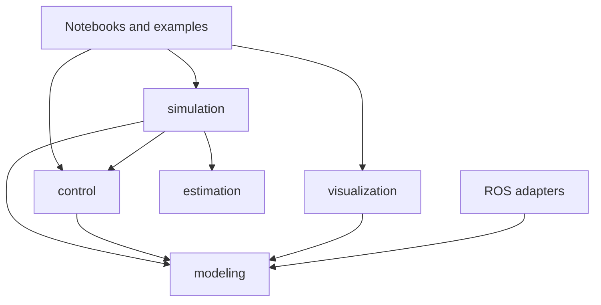

# Robotics Core

The core contains the canonical leg geometry, parameterized rigid-body models,
research controllers, estimators and numerical experiments. It runs independently
of ROS. The synthetic NB1–NB6 studies establish software behavior for their stated
inputs; physical parameter identification and robot controller selection remain
separate work.

## Package responsibilities

| Package | Owns | May depend on core packages |
| --- | --- | --- |
| `modeling` | Geometry, kinematics, mass properties, dynamics, contact laws and prescribed trajectories | `modeling` |
| `estimation` | Filters and replay of explicit sensor channels | `estimation` |
| `control` | LQR/MPC, torque feasibility, inverse-dynamics allocation and task/supervisor policies | `control`, `modeling` |
| `simulation` | Initial conditions, plant stepping, sensor synthesis, fault injection, comparison runs and traces | `simulation`, `modeling`, `control`, `estimation` |
| `visualization` | Plots and animation of model outputs | `visualization`, `modeling` |

Notebooks and examples compose these APIs. ROS adapters live in
`robot/software/ros2_ws/src`; they consume the core and own ROS messages, TF and
node lifecycle. The core has no reverse dependency on ROS, notebooks or tools.
The [architecture tests](../../robot/software/core/tests/test_architecture.py)
check these dependency directions, import cycles and geometry imports in an
interpreter without installed optional packages.

## Simulation entry points

| Study | API |
| --- | --- |
| NB3 | `duk_core.simulation.planar.simulate_planar` |
| NB4 | `duk_core.simulation.balance.simulate_balance` |
| NB5 | `duk_core.simulation.height.compare_height_policies` |
| NB6 | `duk_core.simulation.whole_body.run_whole_body` |

The spatial experiment coordinates four internal components. Initialization
binds the starting stance and fallback design. The observation/guard component
owns sensor replay, friction belief and integration stop conditions. The
reference component owns feature transitions, anchors and acceleration tasks.
The command component selects allocator output, fallback or stop. Named trace
columns preserve field meaning independently of dataclass declaration order.
These helpers are private implementation details of `simulation`.

The refactor moved the former `modeling.planar_experiment` and
`control.whole_body_experiment` entry points to the paths above. NB4/NB5 runners
also moved out of `control`; their controller algorithms remain there.
`HipTrajectory` now belongs to `duk_core.modeling.trajectories`. Repository
callers use the new paths. External research scripts using the old imports need
the same update.

## Coordinates, inputs and dependencies

Geometry remains authoritative in
[duk_leg_geometry.json](../../robot/config/physical/duk_leg_geometry.json).
A is the planar origin, +x points right, +y up and CCW is positive. The linkage
coordinate is the directed angle AB→DA, with θ_AB = θ_DA − q and θ_DA = −30°.
The [modeling reference](../theory/modeling.md) defines the geometry and dynamics
conventions. Geometry APIs use millimetres where named; dynamics use SI units.
Conversions occur at their existing model boundaries.

Physical values must be bound explicitly. The
[synthetic experiment fixture](../../research/experiments/duk-v3/synthetic.json)
is separate from the
[unidentified parameter template](../../robot/config/physical/duk_planar_parameters.example.json).
Core modules do not discover a repository fixture or choose a scenario at import
time. Notebook/example callers supply those inputs.

Geometry and mass-property primitives require only Python. Symbolic construction
loads SymPy explicitly; numerical studies use the optional research dependency
set. Package initializers keep these dependencies out of lightweight imports.
Animation consumes canonical solved poses and updates drawing artists without
reimplementing the mechanism.

[Core usage and notebooks](../../robot/software/core/README.md) ·
[Engineering rules](../development/engineering-rules.md) ·
[Testing](../development/testing.md).
