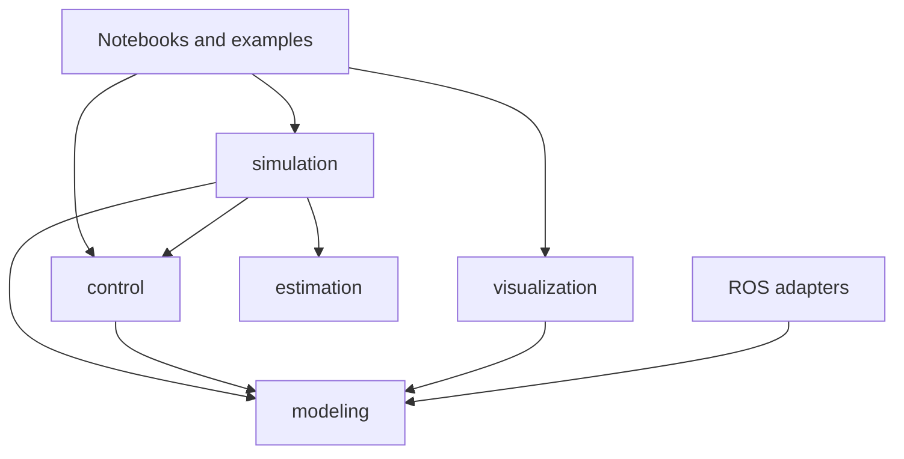

# Robotics Core

The core contains the canonical leg geometry, parameterized rigid-body models,
research controllers, estimators and numerical experiments. It runs independently
of ROS. The synthetic NB1–NB6 studies establish software behavior for their stated
inputs; physical parameter identification and robot controller selection remain
separate work.

## Package responsibilities

| Package | Owns | May depend on core packages |
| --- | --- | --- |
| `modeling` | Geometry, kinematics, mass properties, dynamics, contact laws and prescribed trajectories | `modeling` |
| `estimation` | Filters and replay of explicit sensor channels | `estimation` |
| `control` | LQR/MPC, torque feasibility, inverse-dynamics allocation and task/supervisor policies | `control`, `modeling` |
| `simulation` | Initial conditions, plant stepping, sensor synthesis, fault injection, comparison runs and traces | `simulation`, `modeling`, `control`, `estimation` |
| `visualization` | Plots and animation of model outputs | `visualization`, `modeling` |

Notebooks and examples compose these APIs. ROS adapters live in
`robot/software/ros2_ws/src`; they consume the core and own ROS messages, TF and
node lifecycle. The core has no reverse dependency on ROS, notebooks or tools.
The [architecture tests](../../robot/software/core/tests/test_architecture.py)
check these dependency directions, import cycles and geometry imports in an
interpreter without installed optional packages.

## Simulation entry points

| Study | API |
| --- | --- |
| NB3 | `duk_core.simulation.planar.simulate_planar` |
| NB4 | `duk_core.simulation.balance.simulate_balance` |
| NB5 | `duk_core.simulation.height.compare_height_policies` |
| NB6 | `duk_core.simulation.whole_body.run_whole_body` |

The whole-body allocator solves weighted or hierarchical acceleration tasks.
Before optimization, it includes fixed effort/contact-force bounds in the hard
equalities and uses a row-normalized SVD to express the scaled decision vector
as `x = x0 + Z y`. Only the free coordinates `y` reach the optimizer; friction
and remaining bounds are projected into that space. This also handles flight,
where zero contact forces can make otherwise distinct equality rows dependent.
Each hierarchical stage locks its attained task output before the next stage.
The original dynamics, contact equations, force/effort/travel bounds and locked
outputs are checked before returning a command. The objective, priority order
and physical constraints are unchanged by this numerical reduction.

The spatial experiment coordinates four internal components. Initialization
binds the starting stance and fallback design. The observation/guard component
owns sensor replay, friction belief and integration stop conditions. The
reference component owns feature transitions, anchors and acceleration tasks.
The command component selects allocator output, fallback or stop. Named trace
columns preserve field meaning independently of dataclass declaration order.
These helpers are private implementation details of `simulation`.

The refactor moved the former `modeling.planar_experiment` and
`control.whole_body_experiment` entry points to the paths above. NB4/NB5 runners
also moved out of `control`; their controller algorithms remain there.
`HipTrajectory` now belongs to `duk_core.modeling.trajectories`. Repository
callers use the new paths. External research scripts using the old imports need
the same update.

## Coordinates, inputs and dependencies

Geometry remains authoritative in
[duk_leg_geometry.json](../../robot/config/physical/duk_leg_geometry.json).
A is the planar origin, +x points right, +y up and CCW is positive. The linkage
coordinate is the directed angle AB→DA, with θ_AB = θ_DA − q and θ_DA = −30°.
The [modeling reference](../theory/modeling.md) defines the geometry and dynamics
conventions. Geometry APIs use millimetres where named; dynamics use SI units.
Conversions occur at their existing model boundaries.

Physical values must be bound explicitly. The
[synthetic experiment fixture](../../research/experiments/duk-v3/synthetic.json)
is separate from the
[unidentified parameter template](../../robot/config/physical/duk_planar_parameters.example.json).
Core modules do not discover a repository fixture or choose a scenario at import
time. Notebook/example callers supply those inputs.

Geometry and mass-property primitives require only Python. Symbolic construction
loads SymPy explicitly; numerical studies use the optional research dependency
set. Package initializers keep these dependencies out of lightweight imports.
Animation consumes canonical solved poses and updates drawing artists without
reimplementing the mechanism.

The notebook presentation module provides scalar HTML result tables, categorical
timelines and cached-case figure pickers. It consumes arrays and drawing callbacks,
without importing simulation runners. The first selected figure is also a normal
notebook output for reading executed copies without a widget manager. Interactive
changes require a live kernel. Timelines preserve the actual terminal time and
show an instantaneous stop as a marker rather than inventing a final interval.
The held-signal plotter repeats the final command only through the actual interval
end, preserving partial intervals and NaN gaps for rejected commands. Continuous
state curves remain separate from these zero-order-held command curves.

`NumericPlanarBiped.center_of_mass_acceleration` computes the mass-weighted body
accelerations `J a + Jdot v` in world `(x, z)` coordinates. The planar simulation
uses its vertical component for contact-force diagnostics. This avoids finite
differences at neighbouring configurations, which can leave the physical assembly
branch even when the simulated state is valid. Tests compare the acceleration
with independent CoM position differences and whole-system linear momentum.
For symmetric prescribed hip motion, `upper_body_angle_derivatives(q)` combines
the same body Jacobians and analytic curvature about the common axle. NB5 uses
these angle derivatives instead of probing nearby postures. The underlying
atan2 derivative primitive is shared with the spatial task acceleration bias.

Velocity replay validates the complete synchronized record before changing its
observer. Times must increase, numerical channels must be finite and contact
flags must be boolean. Index zero is the initial prior, not an accepted odometry
correction; later accelerations describe the interval ending at that sample.
Spatial impulse scheduling likewise respects command sample times: a configured
impulse is applied once at the first sample at or after its requested time,
and is not applied when no such command sample remains.

Control problem validation is shared within the control package. State-space
matrices must have consistent finite dimensions; state/terminal quadratic weights
are symmetric positive semidefinite, and effort weights positive definite.
The finite-horizon LQR and condensed MPC implementations are checked against an
independently recovered full quadratic minimum. Empty force-constraint rows are
valid in MPC; motor bounds still apply. Invalid data raises `ValueError`, distinct
from an infeasible solve returning `None`. Central-difference linearization copies
each callback result before the next evaluation can overwrite a reused buffer.

Contact force evaluation validates finite channels, broadcast dimensions and
nonnegative friction before computing forces. The compliant law retains
unilateral normal support and dissipative regularized tangential force, with one
or two tangent components. The wheel-pendulum slip law checks the same friction
sign and requires a positive slip scale.

The spatial observer uses `||F_t||₂ / N` when updating its friction belief during
sliding with sufficient support. This matches the isotropic plant's force norm
and avoids a direction-dependent estimate from `|F_x| + |F_y|`. The allocator
retains its linear inscribed friction cone. `WholeBodyTrace` records independent
snapshots of `friction_belief` and the synthetic `actual_friction` input. Force
observations remain from the preceding integration substep; a surface change can
precede observation, as shown in the low-grip notebook chart.

Feature participation exposes its piecewise-linear rate. The bounce reference
uses the product rule for height, rate and the regular acceleration within each
ramp segment. Starts, target changes, saturation and pause can change that rate
discontinuously; no acceleration-smooth envelope or impulsive acceleration is
introduced. Geometry, task weights and ramp-time settings are unchanged.

The notebook runner owns execution provenance. Saved notebooks embed source/input
hashes, Git state and Python/package versions; the run directory also stores that
manifest and a source/input archive, including files not yet committed. Interactive
setup cells print the commit/dirty state and input hashes; use the runner's saved
outputs when the complete execution record is needed.

The [Notion v3 correction review](../../research/experiments/duk-v3/notion-v3-review.md)
documents the canonical CCW to +x pendulum mapping and source provenance.
The core retains its correct `Ȯₓ + rφ̇ = 0` rolling sign and canonical wheel-force
estimate. Pendulum pole/zero diagnostics live in `modeling/wheeled_pendulum.py`;
projected A–wheel clearance lives in `modeling/kinematic_bench.py`. Both expose
model diagnostics without introducing unidentified hardware parameters.

[Core usage and notebooks](../../robot/software/core/README.md) ·
[Engineering rules](../development/engineering-rules.md) ·
[Testing](../development/testing.md).
